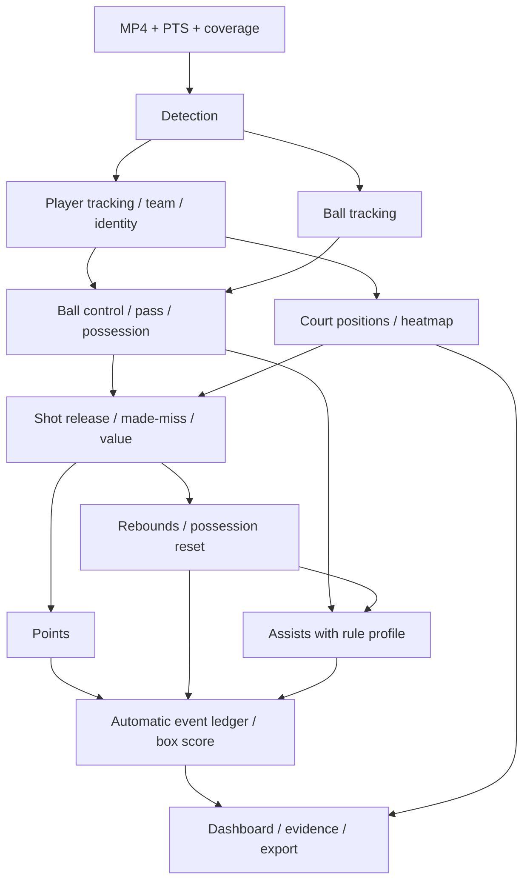

# PLAN v2 — Heatmap & Automatic Points / Rebounds / Assists

Kế hoạch demo mới để review theo yêu cầu 2026-11-16: [PLAN-DEMO-20261116.md](PLAN-DEMO-20261116.md) và [prompt tổng thực thi D01–D12](docs/prompts/demo-completion-20261116/00-master-execution.md). Kế hoạch mới gom approvals và cho phép tiếp tục task độc lập khi một phase chờ review; không thay targets nghiệm thu hoặc đánh dấu 06A/06B PASS.

Cập nhật 2026-11-16: [Quality protocol revision và run mở rộng](docs/reports/quality-revision-20261116.md), **485 tests PASS, 1 skipped, 61 subtests PASS**. Đã thêm profile basket-primary theo yêu cầu người dùng, giữ profile cũ để đối chiếu; sửa source/timeline scope và canonical point-value loading. Run CPU trên video gốc 0–1000s đang chạy nền với heartbeat, chưa có kết quả hoàn tất. Fine-tune mới chờ review bbox/visibility cho batch near-rim; không đổi default model hoặc nới FSM observation-gap guard. Quality Gate 06A và đóng gói nghiệm thu 06B chưa được nâng PASS; bộ dữ liệu cùng trận/sparse coverage chỉ hỗ trợ diagnostic trong revision này.

Cập nhật 2026-11-15: [Phục hồi Training Readiness & Fine-tune Task07](docs/reports/task07-finetune-recovery-20261113.md), **405 tests PASS, 1 skipped, 61 subtests PASS**. Đã chứng minh detection loss thật trên CUDA RTX 2050 (loss 6.0142, finite gradients 366 tensors, $\Delta \text{loss} = 14.20$). Hoàn thành cả 2 candidate runs (pilot `57601e0d...` và candidate `a6c0c6ea...`). Paired evaluation: Pilot val Ball recall $+2.59\%$ ($82.28\% \to 84.87\%$), test mAP50 $+0.0110$; Candidate val Ball recall $+0.75\%$, mAP50 $-0.0063$. Quyết định: **REJECTED promotion cho cả 2 candidates**, model mặc định giữ nguyên `phung-van-tri/basketball-xil7x-y8g6u-1-yolo26s-t1` (ONNX CPU). Task07 tiếp tục **IN_PROGRESS**.

Cập nhật nghiệm thu 2026-11-10: [report](docs/reports/demo-completion-acceptance-20261110.md) — **REQUEST CHANGES / MVP CHƯA NGHIỆM THU**. Tests hiện có 367 + 61 subtests PASS; independent probes 39 fail/1 pass; browser 10 pass/8 fail. Task08–15 IN_PROGRESS theo bằng chứng, không giữ các claim ACCEPTED trong bàn giao 2026-11-09. Dataset QA đạt phạm vi integrity/hình học; candidate không có process/epoch weights, official negative specificity và strict PRA metrics chưa khả dụng.

Cập nhật 2026-11-08: [Nghiệm thu Task07C](docs/reports/task07c-acceptance-report-20261107.md), **FAILED CRITERIA — Task07 TIẾP TỤC IN_PROGRESS**. Pipeline freeze đã chạy trên cả validation và development theo protocol đã chốt. Integrity guards đạt 100% PASS (0 prediction-only control, 0 cut crossing pass, PTS error $\le 2\mu\text{s}$). Các tiêu chí bắt buộc thất bại: Ball recall 50.00% (mục tiêu $\ge 90\%$), Strict control accuracy 0.00% (mục tiêu $\ge 90\%$), Strict pass recall 0.00% (mục tiêu $\ge 90\%$). Validation thiếu GT đã duyệt. Đã lập [acceptance manifest](codebase/outputs/task07c-acceptance-20261107/manifest.json) và [handoff Task08](docs/handoffs/task07c-to-task08.md) cho phép dùng player tracks/team/court/cuts, cấm tự động dùng assists/rebounds/ball flight. Giữ nguyên Task04–06.

Cập nhật 2026-11-07: [Task07B decoupling & paired evaluation](docs/reports/task07b-decoupling-20261107.md), **309 tests PASS**. Tách biệt thành công actor context (`role != 'non_player'`), loại bỏ 100% regression ball recall của Full Guard (50.00% vs 45.83%). Candidate `jersey + conflict-reset` giảm 89.5% thời gian gán sai team (0.633s -> 0.067s). Truy nguyên 7 tầng xác nhận raw detector miss (40.3% thời lượng) và thiếu số áo OCR là nút thắt cốt lõi khiến strict control/pass đạt 0%. Đã lập kế hoạch fine-tuning detector chờ phê duyệt. Task07 tiếp tục **IN_PROGRESS**, chưa đủ điều kiện freeze cho 07C.

Cập nhật 2026-11-06: [Task07B crop/ownership/team](docs/reports/task07b-crop-ownership-20261106.md), 290 tests PASS. Team-conflict reset candidate sửa 2 team errors trên 7 snapshot, ball 50% giữ nguyên; fullguard regression không promote. Strict control/pass vẫn 0%, Task07 IN_PROGRESS, chưa freeze 07C. Không train/đổi weights.

Cập nhật dataset-first07A đã duyệt: [QA ảnh và pilot359frame](docs/reports/task07a-dataset-first-20261105.md),257tests PASS. Chuẩn bị dữ liệu chờ human review; chưa training/weights/cost approval, chưa đạt accuracy. Task07 IN_PROGRESS;07B/07Cchưa qua gate.

Thử nghiệm development hiện hành: [spatial reliability v4](docs/reports/task07-spatial-reliability-20261104.md),240tests PASS; ball recall50%, strict control/pass0%. Có sửa ball ROI/consensus, chưa chứng minh OCR accuracy tăng hoặc khả năng video bất kỳ; Task07 IN_PROGRESS. Các metrics43.06% phía dưới là baseline trước v4.

Cập nhật full evaluation Task07: [development v2](docs/reports/task07-development-evaluation-v2-20261104.md) đã có reviewed GT, đủ minimum samples nhưng `failed_criteria` (ball43.06%, strict control0%, pass recall0%). Task07 **IN_PROGRESS vì recognition chưa đạt**; validation GT còn chờ. Các snapshot “GT development pending” dưới đây đã được thay bằng kết quả này.

Cập nhật pilot mới nhất 2026-11-04: [Task07 Vietnam–Tonga](docs/reports/task07-vietnam-tonga-segments.md), **233 tests PASS** và integrity audit hai đoạn 30s. Roster thật/protocol đã duyệt; nhãn chưa review, ball/player-control/pass còn thiếu coverage, chưa có completed pass, **Task07 IN_PROGRESS**. [Handoff và bước đo tiếp theo](docs/handoffs/task07-vietnam-tonga.md). Hai đoạn cùng trận đã xem để triage, không phải untouched independent validation. Các counts 207/153 bên dưới giữ làm lịch sử.

Ngày: 2026-11-02. **ACTIVE** theo [MVP đã duyệt](docs/MVP-v2-proposal.md). [Kế hoạch cũ](docs/archive/2026-11-02-pre-auto-stats/README.md) là lịch sử. Task01–02 giữ nghiệm thu baseline, chưa phải nghiệm thu PRA tự động.

## 1. Mục tiêu đã chốt

MP4 3x3 một rổ, camera ổn định, hai đội phân biệt được; tự phát sinh points/rebounds/assists theo đội/cầu thủ, heatmap và stats vùng. Chọn điểm sân, ROI, roster và ruleset trước phiên được phép; nhập/xác nhận từng pha không phải đường đi chính. Correction chỉ phục vụ audit, không thay kết quả tự động khi nghiệm thu.

Giữ MP4 offline trước, cập nhật theo source timestamp; live ở FPS nguồn có gate benchmark riêng. Chưa cam kết video bất kỳ, mọi quyết định trọng tài hoặc gần 100%. Số đo CPU theo đúng phiên bản/run ở [report task03](docs/reports/task03-pipeline.md); chưa đạt FPS nguồn.

## 2. Tái sử dụng và dữ liệu còn thiếu

| Đã có | Cần xây/bổ sung |
|---|---|
| Model phung-van-tri/basketball-xil7x-y8g6u-1-yolo26s-t1, classes ball/human/rim | Team/identity, ball-control, pass, shot và event recognition |
| Python 3.12.14, inference-models 0.39.7, ONNX CPU, 31 tests nghiệm thu | Court geometry, heatmap, ledger/box score và dashboard |
| 7 video, 10 nhãn shot, split pilot v1 đã khóa | Ground truth actor/control/pass/rebound/assist/value/identity |
| CFR/VFR audit, smoke artifacts | Dataset v2 tách nhóm và end-to-end evaluation |

Giữ codebase/data/manifest.csv, annotations/ và splits.json nguyên trạng. Dữ liệu mới đặt trong codebase/data/v2/. Clip02 phù hợp phát triển reader/model nhưng một người không đủ làm demo hai đội. Clip04–07 vẫn là holdout v1; chuyển sang calibration cần người dùng duyệt revision, không nằm trong approval chung của sản phẩm.

## 3. Kiến trúc đích



Module nhận input kỹ thuật, không đọc labels/notes để suy stats. Candidate/provisional được thuật toán chuyển sang auto_confirmed/void/unresolved theo cửa sổ causal; không phải người dùng bấm xác nhận. Mỗi sự kiện có dependencies/evidence refs và versions.

## 4. Task và phụ thuộc

Source/config/tests dưới codebase/, tài liệu dưới docs/. Task03–08 hiện hành đã đổi phạm vi, bản cũ ở archive.

| ID | Công việc | Phụ thuộc nghiệm thu | Ngày công ước lượng | Trạng thái |
|---|---|---|---|---|
| [01](docs/tasks/task01.md) | Runtime/model baseline | — | Đã làm | DONE v1 |
| [02](docs/tasks/task02.md) | Shot dataset pilot v1 | 01 | Đã làm | DONE v1 |
| [03](docs/tasks/task03.md) | Video/PTS/detection và contracts nền | 01; clip phát triển | 1–2 | DONE v2 |
| [04](docs/tasks/task04.md) | Dataset v2, rules và evaluation protocol | 02; dữ liệu người dùng | 3–5 + chờ review | IN_PROGRESS |
| [05](docs/tasks/task05.md) | Court calibration và heatmap | 03, phần vị trí 04 | 2–3 | IN_PROGRESS (core tools PASS, geometry/GT pending) |
| [06](docs/tasks/task06.md) | Player tracking, team, identity | 03, 04, ROI 05 | 4–6 | IN_PROGRESS (core tools & OCR provider PASS, OCR weights/data pending) |
| [07](docs/tasks/task07.md) | Ball tracking, control/pass/possession | 03, 04, 06 | 3–5 | IN_PROGRESS (implementation/fixtures/3x3 demo PASS; real accuracy pending) |
| [08](docs/tasks/task08.md) | Shots, made/miss, value, points tự động | 04–07 | 4–6 | IN_PROGRESS (core crossing/continuity, production evaluator & negative cohort PASS; PRA pending detector fine-tune) |
| [09](docs/tasks/task09.md) | Rebounds tự động | 04, 06–08 | 2–4 | IN_PROGRESS |
| [10](docs/tasks/task10.md) | Assists tự động theo ruleset | 04, 06–09 | 3–5 | IN_PROGRESS |
| [11](docs/tasks/task11.md) | Event ledger và box score | 06, 08–10 | 2–3 | IN_PROGRESS |
| [12](docs/tasks/task12.md) | Dashboard, evidence và exports | 05, 11 | 2–3 | IN_PROGRESS |
| [13](docs/tasks/task13.md) | Đánh giá end-to-end từng stat | 04–12, frozen test | 3–4 | IN_PROGRESS |
| [14](docs/tasks/task14.md) | Hiệu năng và streaming-readiness | 13 baseline | 2–4 | IN_PROGRESS |
| [15](docs/tasks/task15.md) | Đóng gói và nghiệm thu cuối | 13, 14 | 1–2 | IN_PROGRESS |

Tổng khoảng **32–52 ngày công**, tương đương khoảng **7–11 tuần ở mức 5 ngày/tuần** khi dữ liệu sẵn sàng; có thể dài hơn nếu phải thu thập/train thêm. Đây là ước lượng sơ bộ, không phải deadline cam kết. Không còn dùng lịch một tuần của Assisted Stats. Task03 và công cụ/thu thập task04 có thể bắt đầu độc lập; bảng này không chỉ dẫn spawn agent.

## 5. Gates

| Gate | Bằng chứng | Nếu chưa đạt |
|---|---|---|
| G0 pipeline | CFR/VFR timestamps, bbox, exports tái chạy | Sửa reader/adapter, chưa skip-frame |
| G1 dữ liệu/rules | Labels PRA + hard negatives, split tách nhóm, profile nguồn/version chốt | Báo dữ liệu còn thiếu; không tuning holdout |
| G2 identity/control | Team/player/controller có bằng chứng, unknown/ID switches được đo | Bổ sung footage/labels hoặc model được phép |
| G3 event engines | Cả points/rebounds/assists tự sinh event và pass logic tests | Không thay bằng manual-entry hoặc bỏ một stat |
| G4 evaluation | Mỗi stat có metrics tự động trên frozen test trước sửa tay | Sửa trên calibration; giữ revision/test exposure |
| G5 delivery | Run tái lập, UI/exports/box score/heatmap và benchmark | Bàn giao partial rõ ràng, không đánh dấu cả MVP DONE |

## 6. Phân công

Bạn cung cấp footage mới hai đội đủ nhìn rõ bóng/số áo; roster và nguồn/session; điểm sân tham chiếu; bộ quy tắc thống kê giải; ground truth actor/control/pass/shot/rebound/assist được rà soát. Quyết định khi cần thêm model, train, GPU hoặc thay đổi phạm vi.

Agent xây reader/adapter, annotation tools/validators, court/heatmap, team/identity, ball control, event engines, ledger/UI, tests, evaluator, benchmark và docs. Không dùng labels hoặc mô tả kết quả trong manifest làm input recognition. Không tự upload media, trả phí, đổi detector hoặc cài GPU stack.

Đã triển khai pipeline task03 và công cụ task04; approval MVP không được diễn giải là engines PRA đã có hoặc đạt chất lượng. [Nghiệm thu 03–04](docs/reports/task03-task04-acceptance.md): G04 còn chờ dữ liệu, rules/protocol và split freeze.

## 7. Contracts và dataset v2

Task04 chốt schema trước khi module sau nghiệm thu:
- data/v2/manifest.csv, splits.json, roster.csv, ruleset.json.
- annotations/player_positions.csv, identities.csv, ball_control.csv, passes.csv, shots.csv, rebounds.csv, assists.csv, coverage.csv, reviews.csv.
- IDs ổn định video/session/player/possession/shot/event; time theo PTS chuẩn hóa; observed/predicted/unknown tách biệt.
- Draft/approved và reviewer/evidence/uncertainty rõ; fingerprint khóa cả labels/reviews/coverage/roster/rules.
- Rule profile chứa giải/version/tài liệu nguồn/case matrix, không chứa kết quả từng pha.
- Mục tiêu thu thập ban đầu ≥50 shots cả made/miss, ≥30 rebound và ≥30 assist positives kèm hard negatives. Đây là mục tiêu lập dataset, không bịa/copy dữ liệu để đủ số. Pilot nhỏ phải báo giới hạn; thiếu nhãn một stat thì chưa nghiệm thu stat đó.

## 8. Evaluation trước sửa tay

Ngưỡng làm việc ban đầu: **precision ≥95%, recall ≥90% cho từng points/rebounds/assists**. Đây là mục tiêu lập kế hoạch, chưa phải kết quả hoặc cam kết gần 100%. Task04 đóng băng protocol/ngưỡng trước test; thay đổi sau test cần revision và quyết định người dùng, không tự hạ để pass.

- Matching một-một theo video/type/time, định nghĩa tie/collision chốt trước. Mốc thời gian dự kiến: score ±0,5s; rebound control ±0,75s; assist đúng score link/pass actors và pass time ±0,75s nếu nhãn cho phép.
- Báo event-only và **strict attribution**: đúng team/player/value/rebound subtype/assist link. Sai actor/value không được tính strict TP; có FP/FN tương ứng.
- Unknown/unresolved trên GT hợp lệ tính vào missed/attribution failures và coverage; không tăng precision bằng cách từ chối phần lớn pha khó. GT không thể kết luận chỉ loại theo policy chốt trước.
- Báo per-video/session, TP/FP/FN, totals/offset, identity/ID switches, control và projected-position errors; cỡ mẫu/uncertainty đi kèm.
- Initial score/box score nếu clip bắt đầu giữa trận là config đã khai báo, không tự tái tạo phần không quay.
- Raw auto và corrected results riêng. Ground truth không phải oracle recognition.
- Heatmap: mục tiêu team accuracy ≥90% kèm unknown/missed rate; median position error ≤5% chiều rộng vùng sân trên labeled visible feet, kèm số mẫu/coverage.

Nguồn rule khởi đầu: [FIBA 3x3](https://about.fiba.basketball/en/our-sport/3x3-basketball), [FIBA Statisticians](https://about.fiba.basketball/en/fiba-game-officials/statisticians). Task04 phải xác minh phiên bản và tính áp dụng stats manual cho giải 3x3, không hard-code suy đoán assist/dead-ball.

## 9. Code và output đích

```text
codebase/src/basketball_scoreboard/
  app.py, config.py, contracts.py, video.py, detector.py, overlay.py
  court.py, heatmap.py, players.py, identity.py, ball.py, possession.py
  shots.py, points.py, rebounds.py, assists.py, events.py, boxscore.py, ui/
codebase/configs/
codebase/data/v2/
codebase/scripts/evaluate_v2.py
codebase/outputs/<run_id>/
  run.json, annotated.mp4, detections.jsonl, trajectories.csv
  ball_control.jsonl, events_auto.jsonl, boxscore_auto.csv
  heatmaps/, corrections.jsonl, evaluation/
docs/specs/, docs/tasks/, docs/prompts/, docs/handoffs/, docs/reports/
```

Đường dẫn module là thiết kế, chưa tuyên bố đã có. Run có versions/hashes/config/evidence/status; lỗi writer không tạo completed giả. Không cần cloud/backend/database nặng.

## 10. Bước tiếp theo

Cập nhật 2026-11-11: [Task11 Core: Ledger & BoxScore Correctness](docs/reports/task11-ledger-correctness-20261111.md) đã hoàn thành triển khai mã nguồn, khắc phục triệt để các lỗi P1-E & P1-F từ nghiệm thu 10/11. Toàn bộ 21/21 independent acceptance probes đạt PASS, 33/33 comprehensive Task 11 tests đạt PASS, 393/393 full codebase tests PASS (0 regressions). Đã kiểm chứng tính bất biến toán học, định danh vật lý ổn định, idempotency khi nạp lại dưới ID mới, ràng buộc nhân quả assist và checkpoint/raw log replay. Task 11 tiếp tục giữ `IN_PROGRESS` để chờ hoàn thiện tích hợp nhận diện và đánh giá PRA toàn diện.

Cập nhật 2026-11-09: [Task08 Temporal Shot Engine](docs/reports/task08-temporal-shot-engine.md) hoàn thành triển khai mã nguồn, bộ test (10 unit tests PASS) và kiểm thử thực tế trên 10 cửa sổ ghi điểm cùng **negative cohort 30 tình huống thực tế duy nhất (0 FP, Specificity 100.0%)**. FSM 4 pha, khẩu độ vành rổ thực tế, shooter history nhân quả $[t-2.0\text{s}, t]$ và team fallback attribution đã sẵn sàng [bàn giao cho Task09 và Task11](docs/handoffs/task08-temporal-shot-engine-to-task09-task11-20261109.md). Task07 và Task08 tiếp tục giữ `IN_PROGRESS` để chờ kết quả fine-tune detector nhằm cải thiện độ bao phủ nhận diện bóng trước khi nghiệm thu toàn diện.

Cập nhật 2026-11-04: [Task07](docs/reports/task07-ball-possession.md) đã có code/CLI/evaluator, 207 tests PASS và demo 447 frames clip04 với roster giả lập/OCR local. [Handoff task08–10](docs/handoffs/task07-to-task08-09-10.md) cho phần độc lập; real control/pass accuracy chưa được nghiệm thu. Người dùng [cho phép clip04 development](docs/decisions/20261104-clip04-development-exposure.md) và ghi exposure nhóm clip04–07. Giữ files/lock v1, nhưng không tiếp tục gọi nhóm này là independent untouched holdout trong đánh giá mới. Quyết định mới thay các yêu cầu bảo vệ tuyệt đối nhóm này trong hướng dẫn lịch sử bên dưới/trước đó.

Tái nghiệm thu lịch sử 2026-11-03: [task05–06](docs/reports/task05-task06-acceptance.md),153 tests PASS và independent artifact audit. OCR provider/weights nay đã có; G04 và real geometry/team/player/control gates tiếp tục mở. Trạng thái Task07 hiện hành theo cập nhật 2026-11-04 ở trên.

[Chỉ mục task](docs/tasks/README.md) và [handoff task03](docs/handoffs/task03.md) là điểm vào. Bắt đầu task03 và công cụ/thu thập task04. Có thể viết contracts/test scaffold phía sau, nhưng chưa nghiệm thu khi thiếu identity/control/data. Task01–02 không làm lại. Không rerun holdout inference để “chuẩn bị”, không theo task03 scoreboard cũ.
