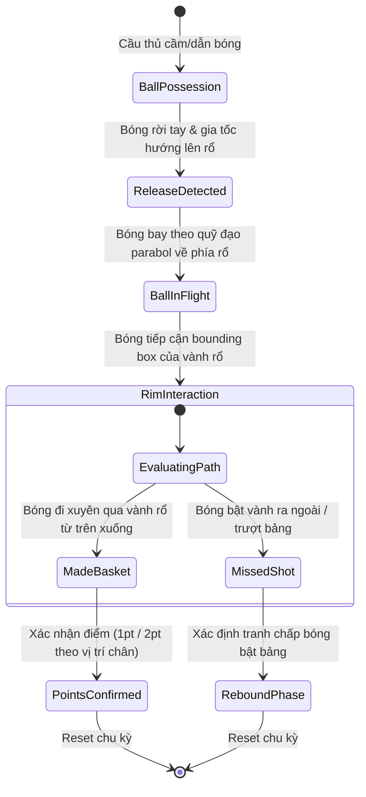

# Bàn Giao Kỹ Thuật: Từ Baseline Chẩn Đoán Sang Thiết Kế Shot & Made/Miss Engine (Task08)

**Ngày bàn giao:** 2026-11-09  
**Trạng thái Task07:** `IN_PROGRESS` (Ball recall & controller accuracy upstream chưa đạt ngưỡng 90%; fine-tune job đang tạm dừng).  
**Trạng thái Task08:** `IN_PROGRESS` (Pha 1: Baseline chẩn đoán hoàn thành; Pha 2: Thiết kế và triển khai Shot & Made/Miss Engine đang tiếp diễn).  
**Tài liệu tham chiếu:**
- [Báo cáo Baseline Chẩn Đoán Task08](../reports/task08-critical-moments-baseline.md)
- [Báo cáo Tiếp Nhận Scoring Review](../reports/task08-scoring-review-intake-20261107.md)
- [Acceptance Report Task07C](../reports/task07c-acceptance-report-20261107.md)
- Artifacts thư mục: [`codebase/outputs/task08-critical-baseline-20261108/`](file:///c:/Users/Admin/OneDrive%20-%20National%20Economics%20University/Documents/object%20tracking/codebase/outputs/task08-critical-baseline-20261108/)

---

## 1. Mục Đích & Phạm Vi Bàn Giao

Tài liệu này tổng hợp toàn bộ kết luận thực nghiệm thu được từ quá trình chạy baseline chẩn đoán trên 10 cửa sổ ghi điểm quan trọng của trận Việt Nam – Tonga, nhằm định hình hợp đồng dữ liệu (data contract), kiến trúc state machine và các ràng buộc kỹ thuật bắt buộc cho kỹ sư/agent tiếp theo khi xây dựng module nhận diện cú ném (`shots.py`) và tự động tính điểm (`points.py`).

---

## 2. Kết Quả Kỹ Thuật Được Bàn Giao (Technical Assets Handed Off)

### 2.1 Khả Năng Quan Sát Của Pipeline (Pipeline Observability)
1. **Quỹ đạo bóng (Ball Tracking):**
   - Đạt **62.05% Observed Ball Coverage** ($883 / 1,423$ frames), và **86.01% Observed + Predicted Coverage** ($1,224 / 1,423$ frames) trên 10 cửa sổ.
   - Quỹ đạo bay (flight arc) từ thời điểm nhả bóng đến rổ có thể khôi phục được nhờ mô hình Kalman filter, nhưng không liên tục $100\%$ do các frame che khuất hoặc bóng di chuyển quá nhanh làm nhòe ảnh (motion blur).
2. **Nhận diện vành rổ (Rim Detection):**
   - Vành rổ được phát hiện chính xác với độ tin cậy cao ở **10/10 cửa sổ ($100\%$)** vào thời điểm bóng tiếp cận rổ.
   - Đây là điểm tựa không gian vững chắc nhất để xây dựng logic kiểm tra bóng rơi qua rổ.
3. **Theo vết và gán đội cầu thủ (Player Tracking & Team Assignment):**
   - Các track cầu thủ duy trì ổn định qua cửa sổ (trung bình hơn 2,000 observations/cửa sổ 4.5s).
   - Phân loại màu áo đồng phục (Team A Đỏ vs Team B Trắng) hoạt động chính xác, đảm bảo gán đúng đội ném bóng (Team Attribution).

### 2.2 Các Giới Hạn Cốt Lõi Đã Được Làm Rõ
1. **Số áo cầu thủ ném bóng bị thiếu tại Release ($8/10$ pha):**
   - Không thể kỳ vọng nhận dạng được số áo ngay tại frame nhả bóng vì góc quay toàn cảnh khiến cầu thủ thường quay lưng hoặc nghiêng người về phía rổ.
2. **Camera ném phạt FT đổi bố cục (`play_006`):**
   - Các pha ném phạt phát sinh góc quay cận cảnh hoặc lia máy (follow-pan). Đa giác Court ROI tĩnh bị vô hiệu hóa trong các góc quay này.
3. **Chưa có Bounding Box Ground Truth & Chưa có Negative Cohort:**
   - Chưa thể công bố IoU Recall hoặc Made/Miss Precision cho đến khi các nhãn này được bổ sung.

---

## 3. Quy Tắc & Ràng Buộc Triển Khai Cho Shot & Made/Miss Engine

Kỹ sư triển khai `shots.py` và `points.py` phải tuân thủ nghiêm ngặt các nguyên tắc sau:

### 3.1 Cấm Đoán Tuyệt Đối (Strict Prohibitions)
- **KHÔNG sử dụng Scoreboard OCR để xác nhận điểm:** Điểm số trên bảng điện tử chỉ phục vụ hiển thị phụ hoặc audit hậu nghiệm; không được dùng thay cho logic nhận diện quang học của đường bóng.
- **KHÔNG dùng Prediction-Only để xác nhận Made Basket:** Bắt buộc phải có ít nhất một bằng chứng quan sát thực tế (**Observed**) của bóng hoặc sự tương tác trực tiếp với vành rổ/lưới tại khu vực rổ.
- **KHÔNG gán ngược danh tính (No Future-to-Past Leakage):** Không lấy danh tính cầu thủ sau khi bóng đã vào rổ để gán ngược cho người ném; việc gán danh tính phải dựa trên bằng chứng trước hoặc tại thời điểm ném.
- **KHÔNG tuyên bố Task08 hoàn tất (DONE) khi chưa có Negative Cohort:** Một engine chỉ thử trên 10 pha ghi điểm thành công sẽ không thể chứng minh khả năng từ chối các cú ném trượt.

### 3.2 Kiến Trúc State Machine Đề Xuất
Engine cần quản lý trạng thái ném bóng theo mô hình hữu hạn (FSM):

### 3.3 Chiến Lược Giải Quyết Danh Tính Cầu Thổ Ném (Shooter Attribution)
1. **Tìm kiếm ngược lịch sử (Track History Back-tracing):**
   - Khi phát hiện bóng rời tay tại thời điểm $t_{\text{release}}$, xác định track ID của cầu thủ gần bóng nhất ($d \le 1.5 \times \text{body\_height}$).
   - Quét ngược lại dòng thời gian của track ID đó từ $t_{\text{release}} - 2.0\text{s}$ đến $t_{\text{release}}$ để trích xuất số áo OCR có độ tin cậy cao nhất khi cầu thủ đang đối diện máy quay.
2. **Cơ chế dự phòng cấp Đội (Team Attribution Fallback):**
   - Nếu trong suốt lịch sử theo vết vẫn không đọc được số áo, hệ thống phải gán điểm cho **Đội (Team Score)** dựa trên màu áo đồng phục đã xác nhận, đồng thời ghi nhận trường `shooter_id = None` và gắn cờ `unresolved_identity`.

---

## 4. Dữ Liệu Bổ Sung Cần Tiếp Nhận

1. **Review Packet BBox Bóng:**
   - Tệp review sơ bộ đã được tạo sẵn tại `outputs/task08-critical-baseline-20261108/draft_review_packet/draft_review_packet.json` gồm 20 frame trọng yếu. Cần người dùng xác nhận bounding box để đo IoU recall.
2. **Negative Event Cohort:**
   - Cần tối thiểu 30 đoạn video có các pha: ném trượt (miss), bóng chạm vành bật ra ngoài, bóng bị chặn (block), mất bóng (turnover), và cắt cảnh phát lại (TV replay).

