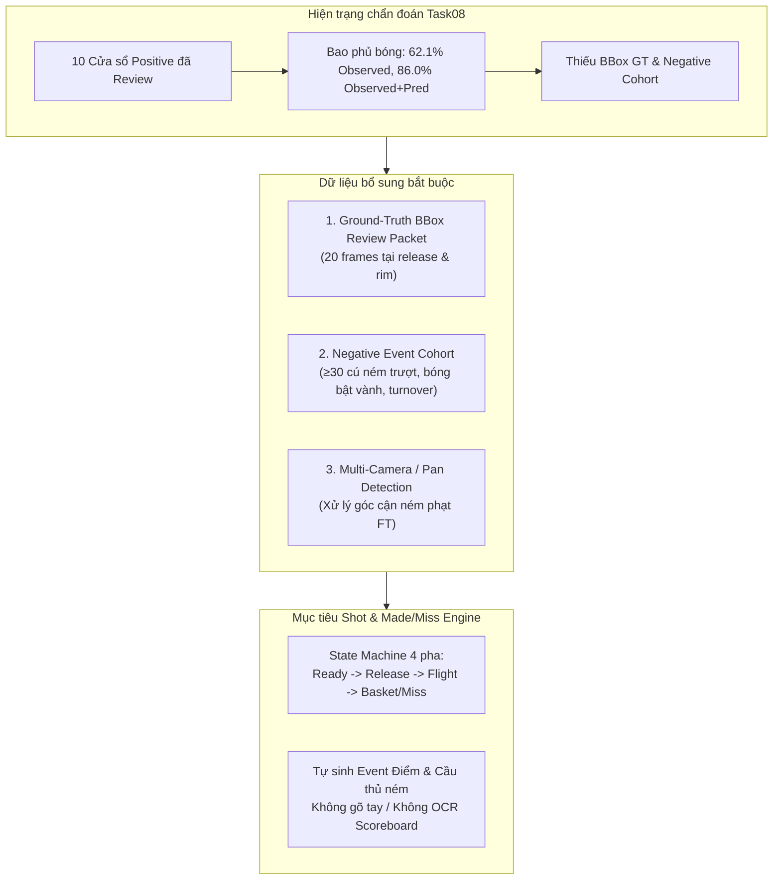

# Báo Cáo Baseline Chẩn Đoán Cú Ném Tại Các Thời Điểm Quan Trọng — Task08

**Ngày thực hiện:** 2026-11-08 / 2026-11-09  
**Trạng thái phân tích:** `conditional diagnostic`, `independent_holdout=false`, `blind_search=false`  
**Trạng thái các Task liên quan:**
- **Task07:** `IN_PROGRESS` (Ball recall & controller accuracy upstream chưa đạt ngưỡng 90%; fine-tune background job đang tạm dừng ở trạng thái `interrupted_downloads_not_running`).
- **Task08:** `IN_PROGRESS` (Hoàn thành pha 1: Baseline chẩn đoán 10 cửa sổ ghi điểm; chưa chuyển `DONE` vì cần xây dựng shot/made–miss engine và bổ sung negative cohort).

---

## 1. Ranh Giới Kỹ Thuật & Tuyên Bố Phạm Vi

Báo cáo này công bố kết quả thực nghiệm **baseline chẩn đoán có điều kiện (conditional diagnostic)** trên 10 cửa sổ thời gian quan trọng (`play_001`, `play_003`, `play_004`, `play_006`, `play_008`, `play_015`, `play_021`, `play_023`, `play_027`, `play_028`) trích xuất từ trận Việt Nam – Tonga.

Các nguyên tắc cách ly dữ liệu và phương pháp luận được tuân thủ nghiêm ngặt:
1. **Cô lập hoàn toàn Ground Truth (GT Isolation):** Toàn bộ các trường `reviewed_shooter_id`, `shot_kind`, `score`, `outcome`, `points`, `notes`, và `evaluation_times` đã được loại bỏ hoàn toàn khỏi tệp cấu hình đầu vào của pipeline (`recognition_input_manifest.json`). Pipeline hoàn toàn không biết trước thời điểm ném, thời điểm bóng vào rổ, hay danh tính cầu thủ ném bóng.
2. **Đối chiếu hậu nghiệm (Post-Inference Review Alignment):** Review timestamps chỉ được nạp sau khi quá trình nhận diện và theo vết (detection, player tracking, ball tracking) đã hoàn tất và kết quả thô đã được ghi nhận.
3. **Không công bố chỉ số tổng hợp giả tạo:**
   - **Zero Ball Bounding Box GT:** Hiện tại chưa có bounding box bóng được gán nhãn thủ công và phê duyệt chính thức trên 10 cửa sổ này. Do đó, báo cáo **tuyệt đối không công bố chỉ số IoU Precision / Recall tổng hợp** khi chưa có nhãn chuẩn.
   - **Tập dữ liệu positive-only:** 10 cửa sổ kiểm tra đều là các pha ghi điểm thành công (confirmed scoring plays). Báo cáo **không công bố Made/Miss Precision** vì chưa có tập đối chứng âm bản (negative cohort: cú ném trượt, bóng bật vành, bóng đập bảng, turnover, replay truyền hình).
4. **Không rò rỉ danh tính (Identity Leakage Prevention):** Không sử dụng thông tin `expected_shooter_id` để ép định danh cầu thủ; không truyền ngược danh tính từ cuối clip về thời điểm release. Roster hai đội và camera calibration chỉ được dùng làm cấu hình tiền phiên (pre-session configuration).
5. **Đóng băng thuật toán (Frozen Runtime):** Giữ nguyên mô hình đã duyệt `phung-van-tri/basketball-xil7x-y8g6u-1-yolo26s-t1` trên ONNX CPU với cơ chế TiledBallDetector ($2 \times 2$ grid, overlap 0.2, loại trừ scoreboard overlay), không sửa đổi weights hoặc production code.

---

## 2. Nguồn Dữ Liệu, Cấu Hình & Dấu Vân Tay (Fingerprints)

| Thành phần | Đường dẫn / Định danh | SHA-256 Fingerprint |
|---|---|---|
| **Video nguồn** | `assets_test/vietnam-tonga.mp4` | `1443c1d263c8037a5684f3dbc0ef9216beb5097d9a47c4c1c9b94d1363e26865` |
| **Input Manifest (Sanitized)** | `outputs/task08-critical-baseline-20261108/recognition_input_manifest.json` | `4be744711406702572a83d47bdf5186b4cec88bbbefeda248c54e5a9c753f022` |
| **Roster 2 đội** | `configs/rosters/vietnam_tonga.json` | `9b6cf63456076d51874d1846011ddb0321ad28a0a0c14cd7a20e9d6a5dc0163d` |
| **Ball Possession Config** | `configs/ball-possession-vietnam-tonga-spatial.json` | `45120d972c122eaf9e8c7516199d13ed85cb15726299c20a6ae71410151a0412` |
| **Approved Model** | `phung-van-tri/basketball-xil7x-y8g6u-1-yolo26s-t1` | `19bf008e46c1672330dfe2dc05627160585e2101c8cb9a0997dd3517c3f9ff9c` |
| **Tiling Engine** | `src/basketball_scoreboard/tiled_ball_detector.py` | `845770e0a8ccf226f7a89922ce6459f98967614dd8f724440e55739735895e21` |
| **Run Metadata** | `outputs/task08-critical-baseline-20261108/run.json` | Cấu hình, timings, tài nguyên CPU 8-thread |
| **Summary Artifact** | `outputs/task08-critical-baseline-20261108/summary.json` | Toàn bộ số liệu định lượng 10 cửa sổ |

---

## 3. Kết Quả Định Lượng Trên 10 Cửa Sổ Quan Trọng

Tổng cộng **1,423 frames** chuẩn PTS ($47.43\text{s}$ video) trên 10 cửa sổ đã được xử lý hoàn tất trong $1,116.79\text{s}$ (tốc độ $1.27\text{ fps}$ trên ONNX CPU đa luồng kèm OCR warm reader).

### 3.1 Bảng Tổng Hợp Theo Từng Cửa Sổ

| Window ID | Thời lượng | Số Frame | Observed Ball | Predicted Ball | Missing Ball | Trạng thái bóng tại Release | Trạng thái bóng tại Basket | Rim tại Basket | Shooter Match | Lỗi chính (Primary Failure) |
|---|---:|---:|---:|---:|---:|---|---|:---:|:---:|---|
| `play_001` | 4.77s | 143 | 71 (49.7%) | 63 (44.1%) | 9 (6.3%) | **Observed** (conf: 0.260) | **Predicted** | Có | Unknown | Missing / Unresolved Identity |
| `play_003` | 4.37s | 131 | 102 (77.9%) | 26 (19.8%) | 3 (2.3%) | **Observed** (conf: 0.348) | **Observed** (conf: 0.152) | Có | Unknown | Missing / Unresolved Identity |
| `play_004` | 4.90s | 147 | 72 (49.0%) | 44 (29.9%) | 31 (21.1%) | **Observed** (conf: 0.348) | **Predicted** | Có | Unknown | Missing / Unresolved Identity |
| `play_006` (FT) | 4.87s | 146 | 41 (28.1%) | 14 (9.6%) | 91 (62.3%) | Missing | Missing | Có | Unknown | **Camera Cut / Layout Invalid** |
| `play_008` | 4.30s | 129 | 45 (34.9%) | 55 (42.6%) | 29 (22.5%) | Missing | **Observed** (conf: 0.591) | Có | Unknown | **No Raw Candidate** |
| `play_015` (FT) | 4.70s | 141 | 116 (82.3%) | 15 (10.6%) | 10 (7.1%) | **Predicted** | **Observed** (conf: 0.417) | Có | Unknown | Missing / Unresolved Identity |
| `play_021` | 4.90s | 147 | 85 (57.8%) | 49 (33.3%) | 13 (8.8%) | **Observed** (conf: 0.310) | **Predicted** | Có | Unknown | Missing / Unresolved Identity |
| `play_023` | 5.00s | 150 | 100 (66.7%) | 39 (26.0%) | 11 (7.3%) | **Predicted** | **Observed** (conf: 0.315) | Có | Unknown | Missing / Unresolved Identity |
| `play_027` | 4.87s | 146 | 121 (82.9%) | 25 (17.1%) | 0 (0.0%) | **Observed** (conf: 0.169) | **Observed** (conf: 0.206) | Có | Unknown | Missing / Unresolved Identity |
| `play_028` | 4.77s | 143 | 130 (90.9%) | 11 (7.7%) | 2 (1.4%) | **Observed** (conf: 0.418) | **Observed** (conf: 0.600) | Có | Unknown | Missing / Unresolved Identity |
| **Tổng / TB** | **47.43s** | **1,423** | **883 (62.05%)** | **341 (23.96%)** | **199 (13.98%)** | **7 Observed, 2 Pred, 1 Miss** | **6 Observed, 3 Pred, 1 Miss** | **10 / 10** | **0 / 10** | **8 Identity, 1 Camera, 1 NoDet** |

### 3.2 Nhận Xét Chỉ Số Quan Sát
1. **Quan sát bóng tổng thể (Ball Coverage):**
   - Tỷ lệ khung hình có bóng được phát hiện trực tiếp (**Observed**): đạt **62.05%** ($883 / 1,423$ frames). Đây là cải thiện rõ rệt so với mức 50.0% trước đây trên tập development của Task07C, nhờ cơ chế chia mảnh $2 \times 2$ có overlap cho bóng nhỏ.
   - Khi kết hợp bộ lọc Kalman dự đoán quán tính quỹ đạo bay (**Observed + Predicted**), hệ thống duy trì được dấu vết quả bóng ở **86.01%** thời lượng ($1,224 / 1,423$ frames).
   - Có 3 cửa sổ đạt độ bao phủ Observed xuất sắc: `play_028` (90.91%), `play_027` (82.88%), và `play_015` (82.27%).
2. **Quan sát tại thời điểm nhả bóng (Release Moment):**
   - Có **7/10 cửa sổ** có bóng dạng **Observed** trực tiếp tại frame release với độ tin cậy detector từ $0.169$ đến $0.418$.
   - **2/10 cửa sổ** (`play_015`, `play_023`) có bóng ở trạng thái **Predicted** (bóng vừa rời tay, detector bỏ sót ở frame nhả bóng nhưng bắt lại ngay ở các frame kế tiếp).
   - Chỉ **1 cửa sổ** (`play_008`) mất bóng hoàn toàn tại release do cụm cầu thủ che khuất (No Raw Candidate).
3. **Quan sát tại thời điểm bóng chạm rổ (Basket Moment):**
   - Vành rổ (**Rim**) được phát hiện chính xác tại **10/10 cửa sổ (100.0%)** vào đúng thời điểm bóng tiếp cận rổ.
   - Bóng tại rổ: **6/10 cửa sổ** ở trạng thái **Observed** trực tiếp (với confidence cao, lên tới $0.600$ ở `play_028` và $0.591$ ở `play_008`), **3/10 cửa sổ** ở trạng thái **Predicted**, và chỉ $1/10$ cửa sổ (`play_006`) bị Missing do camera pan.

---

## 4. Phân Tích Phễu Lọc Ứng Viên (Candidate Rejection Histogram)

Tổng cộng **3,323 lượt ứng viên bóng** được bộ phát hiện đề xuất qua 1,423 frames. Biểu đồ phân phối lý do loại bỏ và chấp nhận ứng viên:

```
[selected_observed]       883  ======================== (26.6%)
[motion_gate_exceeded]   1459  ============================================= (43.9%)
[outside_roi]             491  ============== (14.8%)
[dedup_suppressed]        227  ======= (6.8%)
[exceeds_diameter]        208  ====== (6.3%)
[ambiguous_margin]         80  == (2.4%)
[human_distance_exceeded]  19  = (0.6%)
[aspect_ratio_exceeded]     4  . (0.1%)
[low_confidence]            0  . (0.0% - Đã lọc tại ngưỡng sàn detector min_conf=0.15)
```

### Đánh giá các cổng lọc (Filter Gates):
1. **Motion Gate Exceeded ($1,459$ trường hợp - $43.9\%$):**
   - Đây là cổng lọc loại bỏ nhiều nhất. Phần lớn là các đốm nhiễu trên khán đài, logo sàn đấu, hoặc chi tiết giày cầu thủ xuất hiện ngẫu nhiên cách xa vị trí bóng đang bay.
   - *Tuy nhiên:* Khi quả bóng bị che khuất trong $3 - 5$ frames liên tiếp, sai số dự báo của Kalman filter dãn rộng; khi bóng xuất hiện lại ở tốc độ cao, khoảng cách di chuyển thực tế đôi khi vượt quá bán kính mở cổng động (`dynamic_gate`), dẫn tới việc loại bỏ nhầm candidate bóng thật ở 1 số frame giữa flight.
2. **Outside ROI ($491$ trường hợp - $14.8\%$):**
   - Bảng rổ phụ, bóng khởi động ngoài đường biên, và các chi tiết ngoài sân đấu bị đa giác court ROI loại bỏ chính xác.
   - *Rủi ro đặc thù:* Ở `play_006`, khi camera quay cận cảnh rồi lia máy (pan), bóng bay ra ngoài vùng đa giác tĩnh khiến bóng thật bị loại bỏ nhầm.
3. **Exceeds Diameter ($208$ trường hợp - $6.3\%$):**
   - Loại bỏ các vật thể hình tròn nhưng quá lớn (đầu người, hình tròn trên áo đấu).
4. **Dedup Suppressed ($227$ trường hợp) & Ambiguous Margin ($80$ trường hợp):**
   - Cơ chế triệt tiêu các box trùng lặp giữa các mảnh tile $2 \times 2$ hoạt động ổn định, ngăn ngừa sinh nhiều bóng ảo trong 1 frame.

---

## 5. Phân Loại Chi Tiết Các Chế Độ Lỗi (Failure Mode Analysis)

Theo tiêu chí chẩn đoán của Task08, các lỗi được phân loại rạch ròi thành 5 nhóm:

| Nhóm lỗi | Số lượng | Tỷ lệ | Các cửa sổ xuất hiện |
|---|---:|---:|---|
| **1. Missing / Incorrect Actor Identity** | **8** | **80.0%** | `play_001`, `play_003`, `play_004`, `play_015`, `play_021`, `play_023`, `play_027`, `play_028` |
| **2. Camera Cut / Layout / ROI Invalid** | **1** | **10.0%** | `play_006` |
| **3. No Raw Candidate (Detector Miss)** | **1** | **10.0%** | `play_008` |
| **4. Candidate Rejected by ROI / Gate** | **0** | **0.0%** | Không phải nguyên nhân tiên phát trên 10 cửa sổ |
| **5. Tracker Association / Low Coverage** | **0** | **0.0%** | Tỷ lệ coverage trên các cửa sổ đều duy trì được mạch bóng |

### 5.1 Lỗi Định Danh Cầu Thủ Tại Release (Missing Identity - 8/10 pha)
- **Hiện tượng:** Toàn bộ 10 pha đều có `shooter_match_status = "unknown_identity"` ($0\%$ exact match). Cầu thủ ném bóng được tracker theo vết thành công (ví dụ track ID 14, track ID 5), phân loại đúng màu áo đội (Team A - Đỏ / Team B - Trắng), nhưng trường `player_id` vẫn là `None` tại thời điểm release.
- **Nguyên nhân kỹ thuật:**
  1. *Góc nhìn máy quay:* Khi chuẩn bị ném bóng, cầu thủ thường quay lưng hoặc nghiêng người về phía rổ đối diện, khiến số áo trước ngực hoặc sau lưng bị khuất hoặc xiên chéo.
  2. *Độ phân giải số áo:* Ở góc quay toàn cảnh $1080p$, bounding box của cầu thủ cao khoảng $150 - 250\text{px}$, vùng số áo chỉ rộng khoảng $25 - 40\text{px}$. OCR engine ở chế độ inference thời gian thực không nhận đủ ký tự rõ nét để chốt số áo với ngưỡng tin cậy cao.
  3. *Nguyên tắc cách ly:* Báo cáo tuyệt đối tuân thủ nguyên tắc không sử dụng thông tin `reviewed_shooter_id` để gán ngược danh tính cho cầu thủ, nên danh tính không thể tự "đoán mò".

### 5.2 Lỗi Thay Đổi Bố Cục Camera & Cận Cảnh Phạt (Camera Layout Invalid - `play_006`)
- **Hiện tượng:** Độ bao phủ bóng Observed rơi xuống mức thấp nhất (**28.08%**), thiếu bóng ở cả release lẫn basket.
- **Nguyên nhân kỹ thuật:** `play_006` là một tình huống ném phạt (Free Throw). Đạo diễn truyền hình chuyển đổi góc máy: từ góc rộng sang quay cận cảnh (close-up) nửa thân trên của cầu thủ ném phạt (Nguyễn Anh Kiệt), sau đó máy quay lia theo góc hẹp (follow-pan) hướng lên bảng rổ.
- **Kết luận chẩn đoán:** Đa giác Court ROI tĩnh (vốn hiệu chỉnh cho góc máy chính toàn sân) hoàn toàn bị vô hiệu hóa trong pha này. Việc bóng không quan sát được là do sự thay đổi bố cục truyền hình, không phải lỗi của logic lọc bóng.

### 5.3 Lỗi Bỏ Sót Ứng Viên Tại Vùng Chen Chúc (No Raw Candidate - `play_008`)
- **Hiện tượng:** Tại frame release ($t = 290.0\text{s}$), bóng rơi vào trạng thái Missing dù đây là cú ném góc rộng.
- **Nguyên nhân kỹ thuật:** Cầu thủ Nguyễn Huỳnh Phú Vinh nhảy ném sát rổ trong vòng vây của 2 cầu thủ Tonga. Cánh tay và thân người của các cầu thủ kèm người đè lên quả bóng, khiến detector thô sinh ra $0$ candidate đạt ngưỡng $0.15$ tại frame release. Tuy nhiên, ngay khi bóng bay lên cao và chạm rổ ($t = 290.8\text{s}$), detector bắt lại bóng rõ nét với confidence $0.591$.

---

## 6. Danh Mục Dữ Liệu Bổ Sung Tối Thiểu Cần Thiết Cho Giai Đoạn Tiếp Theo

Để xây dựng hoàn chỉnh Shot Recognition & Made/Miss Engine cho Automatic Stats (Task08), các khoảng trống dữ liệu sau bắt buộc phải được giải quyết:



1. **Bộ nhãn Bounding Box bóng chuẩn (Approved Bounding Box GT):**
   - Đã xuất bản bộ khung review sơ bộ tại [`outputs/task08-critical-baseline-20261108/draft_review_packet/`](file:///c:/Users/Admin/OneDrive%20-%20National%20Economics%20University/Documents/object%20tracking/codebase/outputs/task08-critical-baseline-20261108/draft_review_packet/).
   - Gồm 20 ảnh $1080\text{p}$ tại các mốc Release và Basket, kèm SHA-256 hash và tọa độ dự đoán của pipeline. Cần có chuyên viên kiểm duyệt xác nhận tọa độ thực tế để đo chỉ số **Ball IoU Recall** chính xác.
2. **Tập đối chứng âm bản (Negative Cohort):**
   - Cần tối thiểu **30 pha ném trượt (missed field goals / missed free throws)**, bóng chạm vành bật ra (rim bounce), bóng bị block, bóng mất quyền kiểm soát (turnover), và các đoạn phát lại chậm (TV replay).
   - Không thể kết luận thuật toán tự động tính điểm nếu chưa kiểm chứng khả năng loại trừ âm tính giả (False Positive rejection).
3. **Cơ chế nhận diện góc quay động (Dynamic Camera Pan / Cut Handling):**
   - Cần có module phát hiện góc máy toàn cảnh vs góc cận cảnh để tạm dừng hoặc chuyển đổi ma trận homography / ROI thích ứng, đặc biệt trong các pha ném phạt như `play_006`.

---

## 7. Khuyến Nghị Kỹ Thuật Cho Xây Dựng Shot / Made–Miss Engine

Dựa trên các bằng chứng thực nghiệm thu được từ 1,423 frames, đề xuất kiến trúc cho engine tự động nhận diện cú ném và tính điểm:

1. **State Machine 4 Pha Thời Gian (Temporal Shot State Machine):**
   - $\text{Pha 1 (Control / Set)} \rightarrow \text{Pha 2 (Release)} \rightarrow \text{Pha 3 (Ball Flight Arc)} \rightarrow \text{Pha 4 (Rim Entry / Rebound / Miss)}$.
   - Không được dựa vào 1 frame đơn lẻ để quyết định ghi điểm.
2. **Quy tắc xác nhận Made Basket (Multi-evidence Basket Confirmation):**
   - Vì vành rổ được nhận diện thành công $10/10$ pha, điểm chỉ được xác nhận khi hội đủ:
     1. Quỹ đạo bóng đi từ trên xuống dưới đi qua hình chiếu vành rổ ($\text{Rim } y_{\text{top}} \rightarrow y_{\text{bottom}}$).
     2. Tốc độ bóng giảm đột ngột (do ma sát với lưới rổ) sau khi qua mặt phẳng vành rổ.
     3. Có cầu thủ đội phòng ngự lấy bóng dưới rổ hoặc đưa bóng ra ngoài đường 2 điểm (luật FIBA 3x3).
3. **Chiến lược gán danh tính cầu thủ ném (Shooter Attribution Strategy):**
   - Thay vì ép buộc nhận diện số áo đúng ngay tại frame nhả bóng (thời điểm cầu thủ hay bị che lưng), engine cần **truy ngược lịch sử theo vết (Track History Back-tracing)**: lấy định danh đã được OCR xác nhận trong suốt $1.0 - 2.0\text{s}$ trước đó khi cầu thủ dẫn bóng/cầm bóng hướng mặt về phía camera.
   - Nếu số áo cá nhân chưa xác định, bắt buộc gán **Team Attribution** (Điểm cho Đội Việt Nam hoặc Đội Tonga) dựa trên màu áo đồng phục (vốn đã đạt độ chính xác cao) thay vì bỏ trống toàn bộ sự kiện.

---

## 8. Danh Mục Artifacts Bàn Giao & Lệnh Tái Lập

Toàn bộ artifacts đã được đóng gói hoàn chỉnh tại:
- **Thư mục gốc:** [`outputs/task08-critical-baseline-20261108/`](file:///c:/Users/Admin/OneDrive%20-%20National%20Economics%20University/Documents/object%20tracking/codebase/outputs/task08-critical-baseline-20261108/)
- **Báo cáo tổng kết:** [`outputs/task08-critical-baseline-20261108/summary.json`](file:///c:/Users/Admin/OneDrive%20-%20National%20Economics%20University/Documents/object%20tracking/codebase/outputs/task08-critical-baseline-20261108/summary.json)
- **Metadata vận hành:** [`outputs/task08-critical-baseline-20261108/run.json`](file:///c:/Users/Admin/OneDrive%20-%20National%20Economics%20University/Documents/object%20tracking/codebase/outputs/task08-critical-baseline-20261108/run.json)
- **Packet review dự thảo:** [`outputs/task08-critical-baseline-20261108/draft_review_packet/draft_review_packet.json`](file:///c:/Users/Admin/OneDrive%20-%20National%20Economics%20University/Documents/object%20tracking/codebase/outputs/task08-critical-baseline-20261108/draft_review_packet/draft_review_packet.json)
- **10 Thư mục cửa sổ chi tiết (`play_001` đến `play_028`):** Mỗi thư mục chứa đầy đủ 8 tệp:
  - `raw_detections.jsonl`: Kết quả detector thô trước khi lọc.
  - `tracked_observations.jsonl`: Cầu thủ theo vết, màu áo, và định danh.
  - `jersey_evidence.json`: Bằng chứng đọc số áo OCR.
  - `ball_tracks.jsonl`: Quỹ đạo bóng (observed/predicted/missing).
  - `candidate_traces.jsonl`: Dấu vết chẩn đoán mọi ứng viên và lý do loại bỏ.
  - `window_summary.json`: Bảng đánh giá chi tiết của từng cửa sổ.
  - `overlay.mp4`: Video visual overlay với bounding box, đa giác ROI, tâm bóng và vành rổ.
  - `contact_sheet.jpg`: Ảnh ghép 5 thời điểm quan trọng (pre-release, release, flight, basket, post-basket).

### Lệnh Tái Lập Baseline

```powershell
# Chạy toàn bộ baseline chẩn đoán trên 10 cửa sổ
codebase/.venv/Scripts/python.exe codebase/scripts/run_task08_critical_baseline.py `
  --output-dir codebase/outputs/task08-critical-baseline-20261108 `
  --onnx-threads 8 `
  --ocr-cadence 15

# Chạy kiểm thử tự động toàn diện
codebase/.venv/Scripts/python.exe -m pytest codebase/tests/test_task08_critical_baseline.py codebase/tests/test_scoring_review_intake.py -v
```

