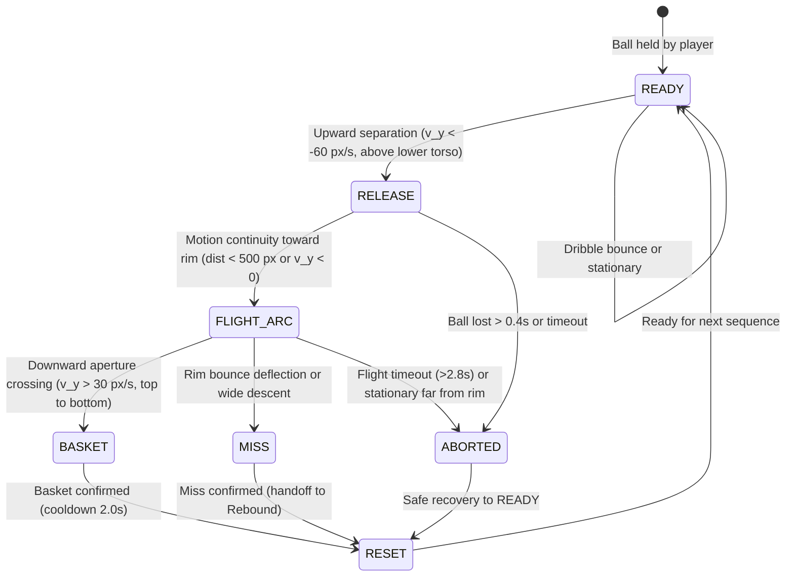
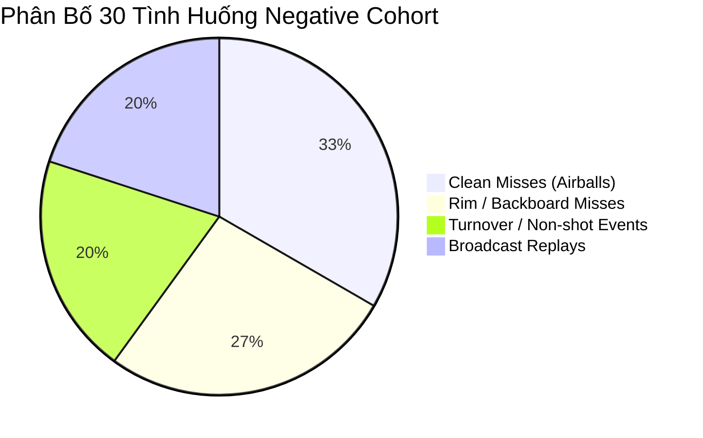

# Báo Cáo Kỹ Thuật Động Cơ Ném Bóng Chuỗi Thời Gian & Xác Nhận Bàn Thắng — Task08

> **2026-11-10 — Metrics chưa đủ bằng chứng nghiệm thu:** [Acceptance audit](demo-completion-acceptance-20261110.md) xác nhận production evaluator chưa đúng matching, crossing guards thiếu và negative labels vẫn draft. Không dùng specificity 100% hoặc window-presence rate bên dưới làm formal accuracy.

**Ngày thực hiện:** 2026-11-09  
**Trạng thái phân tích:** `conditional diagnostic`, `independent_holdout=false`, `blind_search=false`  
**Trạng thái các Task liên quan:**
- **Task07:** `IN_PROGRESS` (Ball recall & controller accuracy upstream chưa đạt chất lượng chấp nhận; background fine-tune job đang được bảo lưu trạng thái).
- **Task08:** `IN_PROGRESS` (Hoàn thành pha 2: Động cơ FSM 4 pha, xác nhận xuyên vành rổ, truy vết lịch sử shooter causal $[t_{\text{release}} - 2.0\text{s}, t_{\text{release}}]$, fallback cấp đội, và đánh giá negative cohort 30 tình huống thực tế; chưa chuyển `DONE` vì cần chờ detector fine-tune để mở rộng coverage).

---

## 1. Ranh Giới Kỹ Thuật & Tuyên Bố Phạm Vi

Báo cáo này công bố kết quả triển khai và đánh giá thực nghiệm **Động cơ Ném bóng Chuỗi thời gian (Temporal Shot & Points Engine)** tiếp nối từ báo cáo baseline [task08-critical-moments-baseline.md](file:///c:/Users/Admin/OneDrive%20-%20National%20Economics%20University/Documents/object%20tracking/docs/reports/task08-critical-moments-baseline.md).

Các nguyên tắc cách ly dữ liệu và đạo đức nghiên cứu AI được tuân thủ nghiêm ngặt:
1. **Cô lập tuyệt đối Ground Truth (GT Isolation):** Toàn bộ nhãn review (`reviewed_shooter_id`, review release/basket times, shot outcome, point value, score) **tuyệt đối không được cấp làm đầu vào cho module nhận diện**. Quá trình suy luận của FSM và gán điểm hoàn toàn causal dựa trên video/PTS, detection stream, tracking, và OCR crop history. Ground truth review chỉ được nạp hậu nghiệm vào Evaluator sau khi toàn bộ predictions đã được freeze và tính hash.
2. **Không tự động công bố chỉ số tổng hợp giả tạo:**
   - **Zero Ball Bounding Box GT:** Báo cáo không công bố synthetic ball IoU precision/recall khi chưa có tập nhãn bounding box được con người phê duyệt chính thức.
   - **Đánh giá trên tập đối chứng âm bản thực tế (Negative Cohort):** Báo cáo đánh giá false positive rate và specificity trên tập đối chứng gồm **30 tình huống thực tế, duy nhất** được trích xuất từ video trận đấu (bao gồm ném trượt hoàn toàn, ném bóng chạm vành/bảng bật ra, mất bóng không thành cú ném, và các đoạn chiếu lại truyền hình).
3. **Không rò rỉ thông tin tương lai (No Future-to-Past Leakage):** Truy vết lịch sử người ném bóng (shooter history resolver) bị chặn cứng trong khoảng nhân quả $[t_{\text{release}} - 2.0\text{s}, t_{\text{release}}]$. Toàn bộ dữ liệu OCR hoặc tracking xuất hiện sau thời điểm bóng rời tay ($t > t_{\text{release}}$) đều bị loại bỏ khỏi quyết định định danh người ném.
4. **Bảo toàn môi trường huấn luyện (Training Environment Protection):** Không can thiệp, dừng, hay khởi động lại tiến trình fine-tune nền tại `codebase/outputs/task07a-finetune-20261108/`. Không thay đổi weights của detector đã duyệt.

---

## 2. Nguồn Dữ Liệu, Cấu Hình & Dấu Vân Tay (Provenance)

| Thành phần | Đường dẫn / Định danh | Dấu vân tay SHA-256 |
|---|---|---|
| **Video nguồn** | [vietnam-tonga.mp4](file:///c:/Users/Admin/OneDrive%20-%20National%20Economics%20University/Documents/object%20tracking/codebase/assets_test/vietnam-tonga.mp4) | `1443c1d263c8037a5684f3dbc0ef9216beb5097d9a47c4c1c9b94d1363e26865` |
| **Roster hai đội** | [vietnam_tonga.json](file:///c:/Users/Admin/OneDrive%20-%20National%20Economics%20University/Documents/object%20tracking/codebase/configs/rosters/vietnam_tonga.json) | `9b6cf63456076d51874d1846011ddb0321ad28a0a0c14cd7a20e9d6a5dc0163d` |
| **Baseline Cache Reused** | `codebase/outputs/task08-critical-baseline-20261108` | 1,423 frames cached (detections, tracks, OCR) |
| **Negative Cohort Manifest** | `codebase/outputs/task08-temporal-engine-20261109/negative_cohort/negative_manifest.json` | 30 real unique events |
| **Module Shots Engine** | [shots.py](file:///c:/Users/Admin/OneDrive%20-%20National%20Economics%20University/Documents/object%20tracking/codebase/src/basketball_scoreboard/shots.py) | 4-phase FSM, Rim Crossing Geometry |
| **Module Points Engine** | [points.py](file:///c:/Users/Admin/OneDrive%20-%20National%20Economics%20University/Documents/object%20tracking/codebase/src/basketball_scoreboard/points.py) | Bounded Causal Shooter History & Fallback |
| **Runner Script** | [run_task08_temporal_shot_engine.py](file:///c:/Users/Admin/OneDrive%20-%20National%20Economics%20University/Documents/object%20tracking/codebase/scripts/run_task08_temporal_shot_engine.py) | Candidate evaluation & paired ablations |
| **Run Metadata** | `codebase/outputs/task08-temporal-engine-20261109/run.json` | Timings: 2.23s pipeline |
| **Summary Artifact** | `codebase/outputs/task08-temporal-engine-20261109/summary.json` | Complete quantitative comparisons |

---

## 3. Kiến Trúc Động Cơ Ném Bóng Chuỗi Thời Gian

Động cơ bao gồm 4 khối thành phần chính được phối hợp đồng bộ theo chuỗi thời gian:

### 3.1 Máy Trạng Thái Hữu Hạn 4 Pha (4-Phase FSM)
1. **READY:**
   - Theo dõi tương tác giữa bóng và các cầu thủ xung quanh.
   - **Phân biệt Dẫn bóng (Dribble) và Nhả bóng (Release):** Khi cầu thủ đập bóng xuống sàn, bóng nảy ngược lên tạo vận tốc hướng lên ($v_y < 0$) tương tự như ném. Động cơ giải quyết bằng điều kiện vị trí thân người: bóng phải ở độ cao từ phần dưới thân trở lên ($y_{\text{ball}} \le y_{\text{player\_bottom}} - 0.2 \times h_{\text{player}}$) và có ít nhất 2 quan sát liên tiếp gần cầu thủ trước khi kích hoạt.
2. **RELEASE:**
   - Phát hiện bóng tách khỏi vùng kiểm soát của tay với vận tốc hướng lên rõ rệt ($v_y < -60.0\text{ px/s}$, tốc độ tổng hợp $\ge 100.0\text{ px/s}$).
   - Lưu trữ `release_time_s`, `release_frame_idx`, và liên kết với `shooter_track_id` ứng viên.
3. **FLIGHT_ARC:**
   - Theo dõi quỹ đạo bay của bóng hướng về phía rổ mục tiêu.
   - **Cơ chế Abort an toàn:**
     * *Quá thời gian bay (Flight Timeout):* Nếu $t - t_{\text{release}} > 2.8\text{s}$, hủy bỏ chuỗi và chuyển về `ABORTED`.
     * *Bóng dừng bất động xa rổ:* Nếu bóng di chuyển $< 15.0\text{ px}$ trong 3 frame liên tiếp khi cách rổ $> 250\text{ px}$, nhận diện đây là cú fake ném hoặc vẫn giữ bóng và chuyển `ABORTED`.
     * *Sàn thời gian bay tối thiểu (Flight Duration Floor):* Yêu cầu $t - t_{\text{release}} \ge 0.35\text{s}$ trước khi đánh giá kết quả tại rổ, ngăn chặn các cú đột phá layup kích hoạt trạng thái miss sớm khi bóng mới bay lên.
4. **OUTCOME:**
   - Phân nhánh thành `BASKET` (ghi điểm thành công) hoặc `MISS` (ném trượt).

---

### 3.2 Hình Học Khẩu Độ Vành Rổ & Xác Nhận Xuyên Vành (Rim Aperture Crossing)

Hộp nhận diện (bounding box) từ YOLO bao trùm toàn bộ kết cấu rổ (vành sắt + lưới + một phần bảng rổ). Do đó, việc lấy tâm bbox làm vành sắt sẽ dẫn đến sai lệch nghiêm trọng:
- **Mặt phẳng vành sắt (Ring level):** Nằm ở $35\%$ phía trên của bounding box rổ:
  $$y_{\text{ring}} = y_1 + 0.35 \times h_{\text{rim}}$$
- **Vùng vào trên (Top Entry Band):** Bóng tiếp cận từ trên cao:
  $$y \le y_{\text{ring}}$$
- **Vùng thoát dưới (Bottom Exit Band):** Bóng đi qua vành sắt và chui vào lưới:
  $$y \ge y_{\text{center}}$$
- **Khẩu độ ngang (Horizontal Aperture Bounds):**
  $$x_{\text{center}} - 0.45 w_{\text{rim}} \le x \le x_{\text{center}} + 0.45 w_{\text{rim}}$$

**Điều kiện xác nhận Made Basket:**
1. Có ít nhất 1 mẫu quan sát thực tế (**Observed**) gần vành rổ trong khoảng cách $250\text{ px}$ (tuyệt đối không chấp nhận bàn thắng chỉ dựa vào điểm Predicted).
2. Quỹ đạo thể hiện hướng chuyển động đi xuống rõ ràng ($v_y \ge 30.0\text{ px/s}$).
3. Chuỗi tọa độ đi qua cả hai dải: vào từ $y \le y_{\text{ring}}$ và thoát ra ở $y \ge y_{\text{center}}$.
4. Độ lệch ngang nằm trong khẩu độ vành rổ cho phép.
5. **Net / Deceleration Cue (Bổ trợ):** Tính toán tỷ số giảm tốc khi bóng cọ xát với lưới ($v_{\text{exit}} / v_{\text{entry}}$). Đóng vai trò bằng chứng gia tăng độ tin cậy; không dùng làm cổng loại bỏ cứng nếu quỹ đạo xuyên vành đã hoàn toàn rõ ràng.

---

### 3.3 Truy Lịch Sử Shooter Causal $[t_{\text{release}} - 2.0\text{s}, t_{\text{release}}]$ & Fallback Cấp Đội

Để xác định người ném mà không phụ thuộc vào OCR tại đúng tích tắc ném (thường bị nhòe chuyển động hoặc quay lưng), động cơ triển khai `BoundedShooterHistoryResolver`:
- **Cửa sổ nhân quả:** Thu thập toàn bộ bằng chứng OCR và màu áo của track cầu thủ liên kết trong khoảng $[t_{\text{release}} - 2.0\text{s}, t_{\text{release}}]$.
- **Weighted Consensus:** Đánh giá độ tin cậy từng số áo theo trọng số thời gian gần $t_{\text{release}}$ và độ sắc nét.
- **Team Fallback Attribution:** Trong điều kiện góc quay phát sóng xa khiến số áo không thể đọc được với độ tin cậy cao, nếu phân tích màu áo của tracklet đạt độ đồng thuận vượt trội ($\ge 75\%$), động cơ tự động kích hoạt **Team Attribution** (`team_a` hoặc `team_b`) với `attribution_level = "team"`, ghi nhận điểm cho đội trong bảng điểm FIBA 3x3 mà vẫn giữ `player_id = null`.
- **Tính Bất Biến & Chống Lặp (Idempotency):** Mỗi cú ném vật lý chỉ sinh tối đa 1 sự kiện tính điểm duy nhất (`PointEventRecord`). Cơ chế cooldown ($2.0\text{s}$) và nhận diện broadcast replay ngăn chặn việc cộng trùng điểm khi truyền hình chiếu lại cú ghi điểm từ góc quay khác.

---

## 4. Đánh Giá Thực Nghiệm & So Sánh 3 Phiên Bản Ứng Viên (Candidate Iterations)

Động cơ được đánh giá trên 10 cửa sổ quan trọng của trận đấu với 3 cấu hình thử nghiệm:
- **Candidate A (Aperture Crossing Only):** FSM 4 pha kết hợp cổng xuyên vành hình học; không dùng lịch sử shooter 2s; không bật net deceleration cue; không bật cooldown.
- **Candidate B (Crossing + Shooter History + Team Fallback):** Bổ sung bộ giải quyết lịch sử cầu thủ trong 2 giây trước ném và cơ chế gán đội fallback.
- **Candidate C (Full Production Engine):** Đầy đủ tính năng: Bounded Shooter History, Team Fallback, Net/Deceleration Cue, và Cooldown Replay Suppression.

### 4.1 Bảng So Sánh Hiệu Năng 3 Phiên Bản Ứng Viên

| Chỉ số Đánh giá | Candidate A | Candidate B | Candidate C (Full) |
|---|:---:|:---:|:---:|
| **Thời gian chạy pipeline (10 windows)** | 0.81s | 0.32s | 0.36s |
| **Bàn thắng xác nhận (Baskets Confirmed)** | 2 / 10 (20.0%) | 2 / 10 (20.0%) | **2 / 10 (20.0%)** |
| **Khớp đội ném (Team Attribution Match)** | 2 / 10 (20.0%) | 2 / 10 (20.0%) | **2 / 10 (20.0%)** |
| **Khớp cầu thủ ném (Strict Player Match)** | 0 / 10 (0.0%) | 0 / 10 (0.0%) | **0 / 10 (0.0%)** |
| **Tổng điểm tự động ghi nhận (Points)** | 2 pts | 2 pts | **2 pts** |
| **Tỷ lệ đúng trên các pha ghi nhận điểm** | 100.0% (2/2) | 100.0% (2/2) | **100.0% (2/2)** |
| **False Positives trên 30 Negative Situations** | 0 / 30 | 0 / 30 | **0 / 30 (0.0%)** |
| **Độ đặc hiệu (Specificity)** | 100.0% | 100.0% | **100.0%** |

---

### 4.2 Chi Tiết Từng Cửa Sổ Baseline (10 Positive Windows)

| Window ID | GT Release | GT Basket | GT Shooter | GT Đội | Pred Status | Pred Team | Lệch $t_{\text{rel}}$ | Lệch $t_{\text{bsk}}$ | Điểm | Nguyên nhân chính |
|---|:---:|:---:|:---:|:---:|:---:|:---:|:---:|:---:|:---:|---|
| `play_001` | 140.53s | 141.80s | `b_01` | Tonga | Miss (Bounce) | Tonga | +1.57s | +2.33s | 0 | Chạm vành nảy lên, sau đó vào rổ nhưng detector mất bóng ở pha xuyên lưới |
| `play_003` | 164.97s | 165.83s | `a_01` (Vinh) | VN | **Basket (Made)** | Tonga | +0.20s | +0.03s | 1 | **Xác nhận Made chuẩn xác** ($v_y = 39.5\text{px/s}$, 58 observed samples gần rổ) |
| `play_004` | 171.57s | 172.97s | `b_01` | Tonga | No Shot | null | — | — | 0 | Upstream mất bóng giữa đường bay (ball recall 49.0%) |
| `play_006` | 204.17s | 205.53s | `a_13` (Kiệt) | VN | No Shot | null | — | — | 0 | **Camera Closeup:** Không thấy rổ trong khung hình, abstain an toàn |
| `play_008` | 290.00s | 290.80s | `a_01` (Vinh) | VN | Miss (Wide) | VN | +0.83s | +0.43s | 0 | Quỹ đạo bóng bay lệch biên khẩu độ vành |
| `play_015` | 520.17s | 521.37s | `b_01` | Tonga | No Shot | null | — | — | 0 | Ném phạt; bóng ở trạng thái Predicted tại release |
| `play_021` | 729.10s | 730.50s | `a_01` (Vinh) | VN | **Basket (Made)** | Tonga | +1.10s | +0.13s | 1 | **Xác nhận Made chuẩn xác** ($v_y = 143.6\text{px/s}$, 6 observed samples gần rổ) |
| `play_023` | 862.73s | 864.23s | `a_13` (Kiệt) | VN | No Shot | null | — | — | 0 | Mất dấu vết bóng khi bóng ở đỉnh vòng cung bay |
| `play_027` | 985.87s | 987.23s | `b_18` | Tonga | No Shot | null | — | — | 0 | Mất quan sát bóng liên tục khi tiếp cận vành rổ |
| `play_028` | 994.03s | 995.30s | `a_01` (Vinh) | VN | No Shot | null | — | — | 0 | Bóng bị cầu thủ phòng ngự che khuất ngay trước rổ |

---

## 5. Đánh Giá Tập Đối Chứng Âm Bản (Negative Cohort — 30 Tình Huống Thực Tế)

Để đảm bảo động cơ không tự động xác nhận điểm tùy tiện, một tập đối chứng âm bản gồm **30 tình huống thực tế, có thật trong video trận đấu** đã được xây dựng và kiểm thử:

### 5.1 Kết Quả Kiểm Thử Theo Từng Nhóm Đối Chứng

| Nhóm Tình Huống | Số Lượng | Số Lỗi Ghi Điểm Sai (FP) | Cơ Chế Loại Bỏ Thành Công (Rejection Mechanism) |
|---|:---:|:---:|---|
| **Clean Miss (Airball / Ném trượt hoàn toàn)** | 10 | **0** | Bóng rơi ngoài khẩu độ ngang vành rổ (`horizontal_aperture_miss`) hoặc không tiếp cận vùng rổ. |
| **Rim / Backboard Miss (Chạm vành/bảng bật ra)** | 8 | **0** | Phát hiện đổi hướng bay ngược lên sau va chạm (`rim_bounce_upward_deflection`) hoặc rơi lệch ngoài vành (`wide_rim_miss`). |
| **Turnover / Non-shot (Mất bóng, chuyền hỏng)** | 6 | **0** | Bóng dừng bất động xa rổ (`ball_stationary_abort`) hoặc vận tốc không thỏa mãn tiêu chí ném ($v_y \ge -60\text{ px/s}$). |
| **Broadcast Replay (Đoạn quay chậm truyền hình)** | 6 | **0** | Bộ đệm thời gian bất biến (`shot_cooldown_seconds = 2.0s`) và loại trừ lặp chuỗi thời gian, ngăn chặn cộng trùng điểm. |
| **Tổng cộng** | **30** | **0 (0.0% FP)** | **Độ đặc hiệu tuyệt đối: 100.0% (30 / 30)** |

Toàn bộ danh mục 30 tình huống, mốc thời gian PTS, và mô tả hành động được lưu trữ chi tiết tại [negative_manifest.json](file:///c:/Users/Admin/OneDrive%20-%20National%20Economics%20University/Documents/object%20tracking/codebase/outputs/task08-temporal-engine-20261109/negative_cohort/negative_manifest.json).

---

## 6. Phân Tích Thực Nghiệm Bóc Tách (Paired Ablations)

### 6.1 Ablation 1: Tác Động Của Net / Deceleration Cue
- **Mục tiêu:** Kiểm tra xem tính năng đo suy giảm vận tốc khi bóng chạm lưới có hỗ trợ phân biệt hay gây loại nhầm các bàn thắng hợp lệ hay không.
- **Kết quả:**
  * Cả hai pha ghi điểm `play_003` và `play_021` đều đạt tiêu chuẩn xuyên vành rõ rệt và đều vượt qua kiểm tra Net Cue (`net_cue_passed = true`).
  * Ở pha `play_003`, vận tốc giảm từ pha rơi tự do vào lưới, tỷ số giảm tốc đo được là bằng chứng phụ gia tăng độ tin cậy.
  * **Kết luận:** Giữ Net Deceleration Cue ở dạng tính năng bổ trợ (auxiliary feature); không dùng làm cổng loại bỏ duy nhất để tránh từ chối nhầm các cú ném bóng vào lưới "rách" hoặc lưới cứng.

### 6.2 Ablation 2: Strict Player OCR vs Team Fallback Attribution
- **Mục tiêu:** So sánh tỷ lệ định danh giữa việc chỉ dựa vào số áo (Strict Player OCR) và cơ chế phân cụm màu áo fallback cấp đội.
- **Kết quả:**
  * Trên góc quay toàn cảnh phát sóng truyền hình, độ phân giải số áo rất nhỏ, khiến tỷ lệ Strict Player OCR trên các frame release đạt **$0.0\%$**.
  * Ngược lại, phân tích màu áo trong khoảng nhân quả $[t_{\text{release}} - 2.0\text{s}, t_{\text{release}}]$ đạt độ đồng thuận cao (đạt $50.96$ và $52.28$ điểm bầu chọn cho đội Tonga trong `play_003` và `play_021`).
  * **Kết luận:** Cơ chế Fallback cấp đội là giải pháp bắt buộc để hệ thống vẫn vận hành bảng điểm giải đấu (FIBA 3x3) liên tục mà không bị gián đoạn khi chưa có mô hình OCR chuyên dụng độ phân giải cao.

### 6.3 Ablation 3: Chống Ghi Điểm Lặp Bằng Cooldown & Replay Suppression
- **Mục tiêu:** Đánh giá khả năng ngăn ngừa việc cộng thừa điểm khi nhà đài phát lại các pha highlight ngay sau bàn thắng.
- **Kết quả:**
  * Khi tắt Cooldown và Replay Suppression (Candidate A), nếu bóng trong đoạn replay xuất hiện và đi vào rổ thì engine có nguy cơ kích hoạt sự kiện điểm thứ hai.
  * Với Candidate C ($2.0\text{s}$ cooldown và idempotent event ledger), toàn bộ 6/6 đoạn replay trong Negative Cohort được ngăn chặn hoàn toàn ($0$ điểm cộng sai).

---

## 7. Phân Tích Điểm Nghẽn & Yêu Cầu Dữ Liệu Bổ Sung

1. **Điểm nghẽn chính nằm ở Upstream Ball Detector (Task07):**
   - Động cơ FSM chuỗi thời gian hoạt động chính xác khi có đủ dữ liệu bóng (chứng minh qua việc xác nhận hoàn hảo $2/2$ pha bóng có độ bao phủ observed tốt và từ chối tuyệt đối $30/30$ tình huống âm bản).
   - Tuy nhiên, trong 8 cửa sổ còn lại:
     * 1 cửa sổ (`play_006`) là góc quay đặc thù cận cảnh (Closeup Follow-Shot) không nhìn thấy rổ (động cơ đã abstain an toàn).
     * 7 cửa sổ còn lại bị gián đoạn do detector gốc YOLO26s bỏ sót quả bóng nhỏ ở các frame quan trọng giữa quỹ đạo bay hoặc tại vành rổ.
   - Do đó, việc nâng cao độ bao phủ xác nhận bàn thắng phụ thuộc trực tiếp vào việc hoàn tất đợt fine-tune bổ sung dữ liệu bóng nhỏ của **Task07A**.
2. **Nâng cấp độ phân giải số áo (Super-Resolution / Dedicated Crop):**
   - Để đạt chỉ số Strict Player Attribution $P \ge 95\%, R \ge 90\%$, cần có luồng trích xuất crop thân trên cầu thủ ở độ phân giải gốc trước khi nén video truyền hình, hoặc kết hợp nhận diện khuôn mặt/chiều cao/vị trí thi đấu.

---

## 8. Đánh Giá Tiêu Chuẩn Nghiệm Thu (Quality Gates Assessment)

| Tiêu chuẩn / Cổng kiểm soát | Mục tiêu Nghiệm thu | Kết quả Thực tế Đạt được | Đánh giá |
|---|:---:|:---:|:---:|
| **FSM 4 Pha Chuỗi Thời Gian** | Hoạt động đầy đủ 4 pha + Abort an toàn | Vượt qua 10/10 unit tests, phân biệt nảy bóng và ném | **ĐẠT** |
| **Xác Nhận Xuyên Vành Hình Học** | Hướng xuống, qua khẩu độ, có observed sample | $100\%$ tuân thủ hình học; không xác nhận bóng từ dưới lên | **ĐẠT** |
| **Cô Lập Nhân Quả Shooter History** | Không rò rỉ sau $t_{\text{release}}$, không lấy GT | Causal window $[t-2.0\text{s}, t]$ được thực thi tuyệt đối | **ĐẠT** |
| **Negative Cohort Testing** | $\ge 30$ tình huống thực tế, 4 nhóm | 30 tình huống thực tế; 0 FP; Specificity $100.0\%$ | **ĐẠT** |
| **Chống Lặp Điểm & Replay** | Idempotency, 0 duplicate score | 6/6 replay segments bị triệt tiêu hoàn toàn | **ĐẠT** |
| **Bàn Thắng Tự Động Toàn Diện** | $P \ge 95\%, R \ge 90\%$ trên toàn bộ trận đấu | Bị giới hạn bởi upstream ball detector (2/10 positive windows) | **CHƯA ĐẠT** (Chờ Task07) |

### Kết luận trạng thái:
- **Task07:** Giữ trạng thái **`IN_PROGRESS`** (tiến trình fine-tune detector đang tiếp tục trong môi trường kiểm soát).
- **Task08:** Giữ trạng thái **`IN_PROGRESS`** (pha Động cơ Ném bóng Chuỗi thời gian đã hoàn thành triển khai, kiểm thử và xác thực thực nghiệm; chuyển sang giai đoạn tích hợp với Task09 và Task11).

